# App Store 截图 v2：内容大纲

草案，2026-11-07。本文只定内容，不定样式：每张图想说什么、写什么、放哪个界面、画面怎么摆。
换样式时只改样式，内容照本文。旧版 7 张截图（2026-10）的界面已经过时，由这一版替换。

## 总览

文案里用 `*星号*` 标出的词是强调色，每个标题只强调一个词。
App Store 搜索结果里只露出前 3 张，所以第 1–3 张最重要。

眉标（`REMOTE` 这类）是样式 A 用的。按后面“风格方向”一节的第 4 条，以后每张图只放一句标题，
眉标只当内部的图名用。

### 当前顺序（第六轮，2026-11-07；2026-11-09 加 Space，8 张）

第 1–2 张合起来做开场（参考 Otter），第 3–8 张讲功能。

2026-11-09 按 App 最新版（`pi-remote` `7e5ab114`）更新：抽屉换成新结构（Agents 行、Tabs、Spaces、Chats 标题带列表/文件夹按钮，底部 `Task`）；标签栏默认顺序 `Chats Todo Updates Wiki Days`（Days 最后）；Providers 已连接的行没有箭头，订阅账号显示剩余用量，`Add provider` 没有副标题，底部说明删掉；Wiki 的 Tags 旁边有 Cards / Map 切换；新加第 7 张 Space，手表顺延到第 8 张。界面仍是 HTML 还原，Space 页 App 侧没有模拟器截图可对照（未验证）。每张图只有一句标题。

跑出手机的元素（pop-up）的规则：参考 Otter，把界面里的一个组件放大拎出来，压在它原本的位置上、伸出手机边框。
手机是什么角度，pop-up 就是什么角度，不额外旋转。

设备风格：第 1–2 张是开场，用实物风格（第 1 张 3D 手机，第 2 张 MacBook Air、iPad、带表带的 Apple Watch Series 11）；
第 3–8 张用正视图：iPhone 17 Pro 银色平面边框，第 8 张的手表是 Apple Watch Series 11 银色铝壳、去掉表带，
和官网 v3 首屏的手表（`site/assets/img/watch-case.webp`）同一种样子。

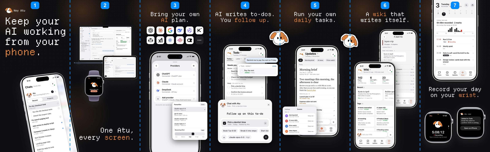

开场定稿为 F（Xinyi 2026-11-07）：第 1 张放带导航的手机（Chats 抽屉打开）；第 2 张 Mac、iPad mini、手表叠放，不放手机，Mac 和手表沿用 B 的大小，iPad mini 按真实比例跟着 Mac。
对话页由第 2 张的 Mac 和 iPad 来展示，它们同时露出导航和对话。A–E 是过程稿。

| 版本 | 第 1 张 | 第 2 张 |
|---|---|---|
| C | 3D 手机，Chats 抽屉打开，Recent 里十来个任务，几个在跑；右侧露出后面的 `Fix the checkout total` 对话 | 多端叠放（同 B）：MacBook 在后面（侧栏加对话），iPad 压在它的右下角（Chats 列表加对话），手表（Series 11 银色、带表带）在最前面 |
| D | 同 C | 照官网 v3 首屏：MacBook 在后面，一台平面手机压在它的右下角（`Fix the checkout total` 对话页），手表在左下最前面；不放 iPad |
| E | 同 C | D 加上 iPad：MacBook 在最后；iPad mini 横屏压住 Mac 的左下；平面手机（对话页）压在 Mac 右下，盖住 iPad 右边一点；手表在 iPad 下面、最前面。大小按真实设备：Mac 当 13 寸 MacBook Air（屏宽 29.0 cm），iPad mini 屏幕长边 17.8 cm，约是 Mac 屏宽的 61%；手机放大约 1.2 倍、手表约 1.9 倍，免得太小看不清。iPad 用苹果官方 iPad mini (A20 Pro) Starlight 边框（`Bezel-iPad-mini-(A20-Pro).dmg`） |
| F（采用） | 同 C | E 去掉手机：MacBook 在后面；iPad mini 横屏压住 Mac 的右下；手表在 Mac 下面、最前面，压住 iPad 的左下。Mac（1200 px）和手表（360 px）沿用 B 的大小；iPad mini 按真实比例跟着 Mac 缩：Mac 屏宽 976 px 当 29.0 cm，iPad mini 屏幕 17.8 cm，边框图宽 666 px |
| B（上一版） | 3D 手机，`Fix the checkout total` 的对话页 | 同 C |
| A（上一版） | 同 C | 第二台 3D 手机，镜像朝向，对话页；MacBook 衬在后面 |

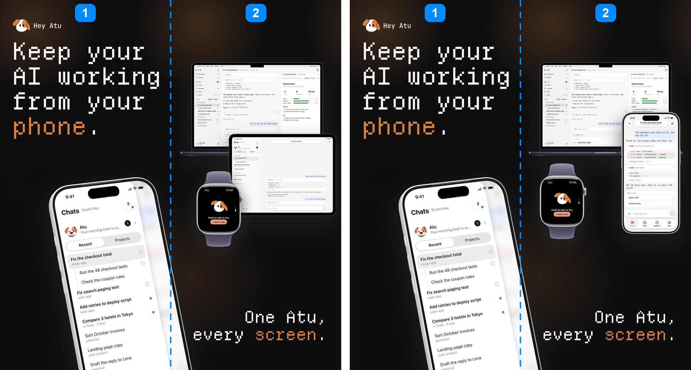

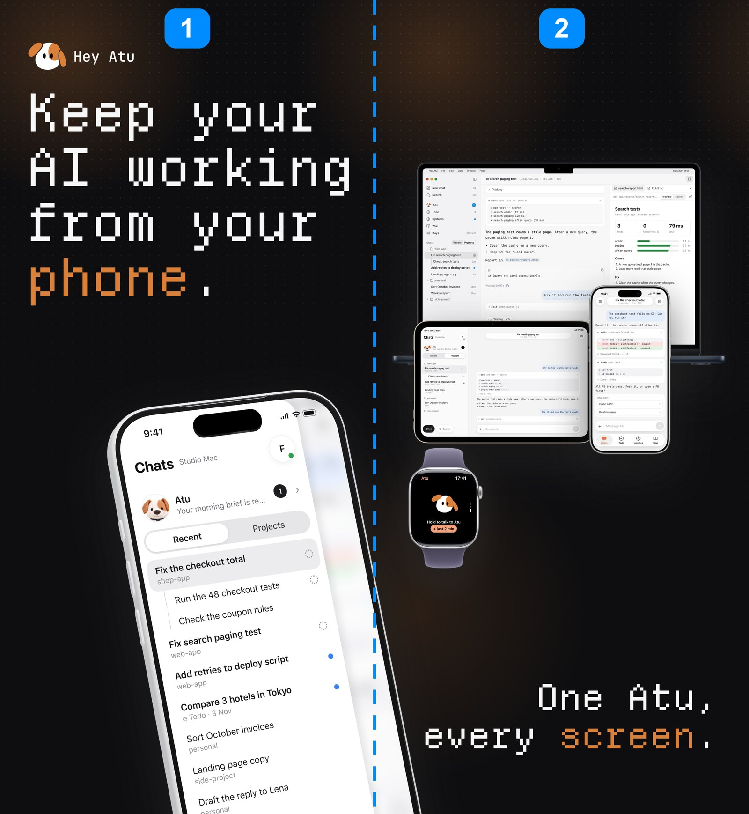

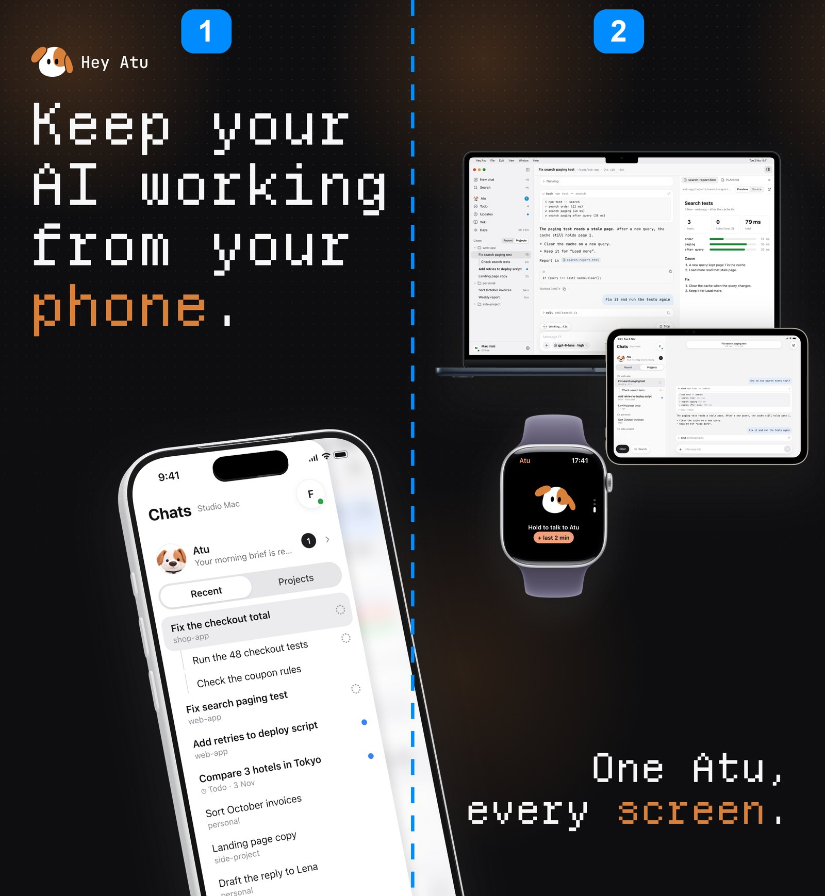

A 的抽屉照 App 现在的样子：宽 `min(320, 屏宽 − 62)`（390 pt 的屏上约 82%），右边两个角圆角 28、带阴影；
右侧露出后面被模糊的对话（系统 ultra thin 材质加 18% 底色）。每行只有标题和项目名，在跑的显示转圈，未读显示蓝点，
不显示时间；子对话缩进、带竖线；底部是 `Chat`、`Search` 和设置。
出处：`../pi-remote/ios/native/App/NativeAppView.swift`（`drawerWidth`）、`NativeDrawerPanel.swift`、`NativeDrawerBlur.swift`。

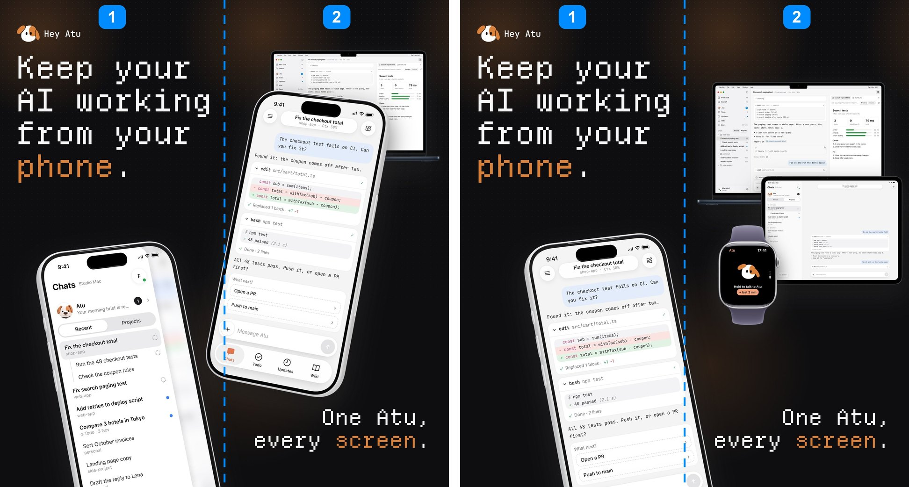

出图：`brand/hey-atu-brand-kit/09-generator/appstore-v2/build.sh`（默认 F）或 `build.sh --open E`（也可以 `A`–`D`），切图在同一文件夹的 `out/r6<版本>-*.png`；定稿 F 的 7 张已提交在 `out/r6f-*`。步骤和素材授权见那里的 [README](../../brand/hey-atu-brand-kit/09-generator/appstore-v2/README.md)。

| # | 想传递的意思 | 文案 | 界面主要展示 | 视觉描述 |
|---|---|---|---|---|
| 1 | 一句话说清楚这是什么：电脑上的 AI 一直在干活，你用手机管它 | `Keep your AI working from your *phone*.` | 手机：左上角的导航打开，Chats 抽屉（Recent）列着十来个任务：`Fix the checkout total`（选中，在跑，下面两个子任务）、`Fix search paging test`（在跑）、两个做完未读，其余是普通对话；右侧露出后面被模糊的对话 | 左上角品牌标 + 大标题，占上半部分；下半部分一台 3D 手机，右边抬高（逆时针约 9°）、露出左侧按键、稍微仰视，偏右放、不居中，从底边出画，右下角伸进第 2 张约 10% |
| 2 | 手机、Mac、iPad、手表上是同一个 Atu | 右下角 `One Atu, every *screen*.` | Mac 上开着桌面端，同时露出侧栏导航和对话 `Fix search paging test`；iPad mini 横屏分栏：左边 Chats 列表，右边同一个对话；手表显示“按住和 Atu 说话” | 几台设备叠在一起（iPad mini 和 Mac 按真实比例），照官网 v3 首屏：Mac 在后面、偏上；iPad mini 横屏压住 Mac 的右下角；手表在 Mac 下面、最前面，压住 iPad 的左下；不放手机，设备之间不连虚线 |
| 3 | 用你已经在付费的 AI | `Bring your own *AI* plan.` / `Works with *25+* AI providers.` | Providers 列表 + 模型选择卡 | 标题下面一行写支持多少家，不放第三方厂商图标墙（商标风险，Xinyi 2026-11-08；Happy、Paseo、Vibe42 都没有图标墙）。25+：Pi 内置 42 条，合并地区和套餐后是 29 家厂商。下面一台放大的手机立正居中，从底边出画；模型卡放大、从右下角跑出手机（不旋转） |
| 4 | AI 替你写好待办，你来跟进 | `AI writes to-dos. You *follow up*.` | Todo 的 Today 页（行上标着 `Added by Atu from a chat`） | 银色手机立正（和其他页一样）。两个 pop-up：右上是 AI 的部分，一句聊天 `Remind me to pay the rent on Friday` 和 `Todo · Added 1` 卡片；下半部分是最大的 Follow up 面板，伸出手机两边 |
| 5 | 每天定时替你跑事 | `Run your own *daily* tasks.` | Updates 页的 Morning brief | 手机立正；定时任务列表放大、从左下角跑出手机（不旋转） |
| 6 | AI 自动把聊天整理成知识库，页面之间互相关联 | `A *wiki* that writes itself.` | Wiki 首页：142 页 / 12 个标签 / 来自 418 个对话，Recent，Tags | 两台手机前后叠放、都立正：前面左下是 Wiki 首页；后面右上稍小的一台是点开 `# Japan trip` 之后的标签页（18 pages · 4 chapters、New this week 的 Kyoto in April、Contents 里按章列出 Flights: Tuesday is cheapest、Rail pass or not、Hotel shortlist、Tokyo budget 等页面和日期），露出上半部分和右侧 |
| 7 | 一句话让 Atu 在你的 Mac 上做一个小 App（Space），它自己保持更新 | `One message, your own *app*.` | 一个叫 `Run log` 的 Space：顶栏是它自己的深绿色（菜单、Atu 标、电脑按钮），近 7 天 21.3 km 柱状图和跑步记录；标签栏里 `Run log` 选中（Space 可以放进标签栏） | 手机立正。两个 pop-up：右边是聊天里的一句 `Make a page of my runs. Update it every morning.` 和 Space 卡片（`Run log · Space · Daily 07:00 · Open`），压在记录列表上、不挡柱状图；左下是点 Atu 标打开的 Space 菜单（Refresh、Change history、Tell Atu to make changes）。不用设计稿里的优惠列表，它全是第三方品牌 |
| 8 | 用 Apple Watch 录下一天，iPhone 上看整理好的 Days，对 Atu 说的事会变成待办 | `Record your day on your *wrist*.` | iPhone 的 Days 页：录音中、今天 5h 08m · 2 个标记、小时柱状图、按小时的记录 | 上下结构，参考 Otter 最后一张：手机在上，从顶边出画，露出日期行以下；标题在中间、居中；下面并排两块手表（Series 11 银色铝壳正视、不带表带、不旋转），左边录音中 `5:08:12`，右边稍高一点是 Atu 的回复 `Added to Todo` |

第 1 张原来的任务页（第三到五轮用过，第六轮换成了对话页；对照 App 的 Todo 任务抽屉，工作中状态）：

- 顶部 `Atu working · 12 min`；标题 `Fix the checkout total before the release`；`Found by Atu · 9:20 · Waits on The tests pass on CI`
- `Now · Atu working` / `Running the 48 checkout tests`，下面黑色按钮 `Open working chat`
- Progress：`9:38 Found it: the coupon comes off after tax`（`src/cart/total.ts`）、`9:31 You Fix it and add a test`、`9:24 Build and review · 1 round · failed`、`9:20 Found by Atu`
- Chats · 1：`checkout total · Working now · shop-app`

### 第一轮的 5 张（界面细节仍然有效）

| # | 想传递的意思 | 文案（眉标 / 标题） | 界面主要展示 | 视觉描述 |
|---|---|---|---|---|
| 1 | 你离开电脑，AI 照样在**你自己的电脑上**干活；手机上就能看进度、回答它的问题 | `REMOTE` / `Keep your AI working from your *phone*.` | Chats 里的一个代码任务：改文件的 diff、测试通过，Atu 问你下一步，上面叠一条推送通知 | 一台手机居中放大；通知横幅压在手机顶部、稍微探出机身，表示“它来叫你了” |
| 2 | 不用另买一份 AI：用你**已经在付费**的 ChatGPT、Claude 订阅或 API key，模型随时切换 | `YOUR AI` / `Bring your own *AI* plan.` | 设置里的 Providers 列表（多家已连接），叠一张模型选择卡 | 手机偏左；模型卡从右下角叠出来，压住手机边缘；厂商 logo 是画面焦点 |
| 3 | Atu 把聊天里冒出来的事记成待办，并分清哪些等你处理、哪些它正在做 | `TODO` / `Keep track of every *to-do*.` | Todo 的 Today 页：Needs you（Review、Reply）、Atu working | 一台手机居中，不叠卡；Needs you 区块在视觉中心 |
| 4 | 让 Atu **每天定时**替你跑事（晨报、新闻、比价、收件箱），结果整理成卡片送到 Updates | `DAILY TASKS` / `Run your own *daily* tasks.` | Updates 页的 Morning brief 场景卡，叠一张定时任务列表 | 手机偏左；任务列表卡从右下角叠出，意思是“设一次，天天收到” |
| 5 | 手机和电脑上是**同一个 Atu、同一批对话**，在哪台设备上都能接着做；扫一次码就配好 | `EVERYWHERE` / `One Atu. *Every* screen.`；小标签 `Pair with one scan` | 一个桌面端窗口和两个手机界面：Chats 列表，以及和桌面端相同的那个对话 | 桌面窗口占上半屏、从右边出画；两台手机在下半屏错开叠在窗口前；三个画面里的项目名和对话标题一致 |

备选（暂不进主线）：

| # | 想传递的意思 | 文案 | 界面主要展示 | 视觉描述 |
|---|---|---|---|---|
| 5a | 回到桌前，在电脑上接着手机上的对话做 | `DESKTOP` / `Pick it up at your *desk*.` | 一个桌面端大窗口，和一台显示同一对话的手机 | 窗口占满上半屏，手机压在右下角 |
| 6a | 抬手就能录音、对 Atu 说一句，结果回到手表上 | `APPLE WATCH` / `Atu on your *wrist*.` | 手表的录音页、“按住和 Atu 说话”页、“已加到 Todo”通知 | 三块手表错落摆放，不放手机。用在 Apple Watch 截图组 |

## 每张图的细节

示例数据都是虚构的，并且全部用英文（审核指南 2.3.9）。同一套截图共用一个设定：

| 项 | 值 |
|---|---|
| 电脑名 | `Studio Mac` |
| 右上角用户头像 | `F` |
| 项目 | `web-app`、`personal`、`side-project`、`shop-app` |
| 状态栏时间 | `9:41` |
| 日期 | 不写具体年份；写星期加日期，例如 `Tuesday, 3 November` |

### 1 · Remote

- 标题备选：`Your AI, in your *pocket*.`
- 推送通知：`HEY ATU · now` / **Fix the checkout total** / `All 48 tests pass. Push it, or open a PR first?`
- 对话内容：
  - 顶部胶囊：`Fix the checkout total` · `shop-app · Ctx 38%`
  - 用户：`The checkout test fails on CI. Can you fix it?`
  - Atu：`Found it: the coupon comes off after tax.`
  - `edit src/cart/total.ts` 卡片，diff 是 `withTax(sub) - coupon` → `withTax(sub - coupon)`，底部 `Replaced 1 block · +1 -1`
  - `bash npm test` 卡片：`✓ 48 passed (2.1 s)`
  - Atu：`All 48 tests pass. Push it, or open a PR first?`
  - 选项卡：`What next?` → `Open a PR` / `Push to main`
- 底部 Tab：Chats（选中）、Todo、Updates、Wiki
- 要让人一眼看到：diff 的红绿行、绿色勾、等你选的两个按钮。

### 2 · Your AI

- 标题备选：`Use the AI you *already* pay for.` / `Your plan. Your *model*.`
- 标题里不写 ChatGPT、Claude 这些厂商名，厂商名只出现在界面里。
- Providers 列表：
  - ChatGPT · `Connected · ChatGPT plan`
  - Claude · `Connected · Claude account`
  - DeepSeek · `Connected · API key`
  - `Add provider` · `ChatGPT, Claude, Zhipu GLM and more`
  - 列表下方写：`Accounts are saved on the Mac, not on this phone.`
- 模型选择卡：
  - 标题 `Favourites`，右上 `Done`
  - 模型：`claude-opus-5-5`（已选）、`gpt-6-astra`、`claude-sonnet-5-5`、`claude-fable-5-1`
  - 底部 `Reasoning effort` 滑杆停在 High
  - 截图前要确认这些模型名和 App 当时的列表一致
- 列表里放 3 家用户最熟悉的厂商就够了，不要堆满。

### 3 · Todo

- 标题备选：`Never lose a *to-do*.`
- 顶部：`Todo` + 齿轮，日期 `Tuesday, 27 October`；分段 `Today 8 · Later 7 · Done 5`
- 现有截图里的待办是产品内部事务，要换成生活和工作都有的示例：

| 区块 | 待办 | 副标题 |
|---|---|---|
| Needs you · Review | Read the reply to Lena | The draft is ready |
| Needs you · Review | Check the Tokyo trip budget | Atu compared 3 hotels |
| Needs you · Reply | Pick a dentist time | Tue 9:30 or Wed 2:00 |
| Needs you · Reply | Confirm the invoice amount | $1,240 or $1,320? |
| Atu working | Watch flight prices to Tokyo | Every morning |

- 底部 Ask 栏：`Ask Atu to plan your day`

### 4 · Daily tasks

- 标题备选：`Your morning, *ready* at 7.`
- 筛选标签全部改成英文：`All · Morning brief · AI news · Price watch · Inbox`（现有截图里还是中文）
- Morning brief 卡片：
  - 日期天气：`Tue, Nov 3 · Sydney 16–22° · Rain after noon`
  - 标题：`Two meetings this morning, the afternoon is clear`
  - 正文：`Review at 9:30 and a 1:1 with Mia at 11:00…`
  - `Waits for you · 2`、`Sydney news` 两段
- 定时任务卡（App 里叫 Scenes）：
  - Morning brief · Every day 7:00 AM
  - AI news daily · Every day 7:05 AM
  - Price watch · Every day 8:00 AM
  - Inbox digest · Weekdays 6:30 PM
- 卡片里不要出现真实项目名（现有截图里有 Loadshift）。

### 5 · Everywhere

- 标题备选：`Your desk. Your *pocket*.`
- 桌面窗口：
  - 侧栏：Atu、Todo、Updates、Wiki、Days，下面是按项目分组的对话
  - 主区：对话 `Fix search paging test`
  - 右侧：`search-report.html` 预览
- 手机 A，Chats 列表，切到 Projects：
  - 顶部 `Chats · Studio Mac`，下面一行 Atu：`Your morning brief is ready.`，带未读 1
  - web-app：`Fix search paging test`（Working · 42 s）、子对话 `Check search tests`、`Add retries to deploy script`（Done · tests pass）、`Landing page copy`
  - personal：`Sort October invoices`、`Weekly report`
  - side-project（收起）
- 手机 B，和桌面端同一个对话：
  - 用户：`Why do two search tests fail?`
  - `bash npm test -- search`，结果 1 过 2 挂
  - Atu 解释原因
  - 用户：`Fix it and run the tests again`
  - `edit web/search.js` 卡片正在转圈
- 三个画面里的项目和对话要逐字一致，这一点是这张图的核心。

## 按尺寸配置

规格以品牌套件里的 [`listing.md`](../../brand/hey-atu-brand-kit/03-stores/app-store/listing.md) 为准。

| 配置 | 尺寸 | 用哪几张 | 说明 |
|---|---|---|---|
| iPhone 6.9" | 1320 × 2868 | 1–5 | 主稿尺寸，先出这一套 |
| iPhone 6.3" | 1206 × 2622 | 1–5 | 由 6.9" 等比缩小 |
| iPad 13" | 2064 × 2752（竖屏） | 1–7 | 照 Otter：iPhone 的第 1–7 张（第 7 张是 Space），手机换成 iPad Pro 13 寸、界面换成 iPad 宽屏布局；第 1 张写 `from your *iPad*.`；不放手表：没有第 7 张，第 2 张只有 Mac 和 iPad mini，因为手表只能配 iPhone（Xinyi 2026-11-08）。`compose_ipad.py` |
| Apple Watch | 上传前按 App Store Connect 现行规格查证 | 6a | Watch App 打包在 iOS App 里，截图单独一组 |
| Google Play | — | 暂不做 | 还没有 Android 版 |

## 审核和事实核对

- **桌面端还没公开**：Hey Atu Desktop 是内部客户端，不进安装包，官网上也没有（ADR 0025）。第 5 张要等它在提交审核前公开才能用。否则去掉桌面窗口，只留两台手机和 `Pair with one scan`。
- **Apple Watch**：只有提交审核的那个 build 里确实带 Watch App，才能放 6a。
- 截图里不能出现 Android、Google Play 这类名字（2.3.10）；必须是 App 的使用状态（2.3.3）。
- 正式版要在模拟器里用一套干净的英文演示数据重新截。产品团队现有的截图里有真实任务、中文标签和真实项目名。

## 现有上架文案（参考）

已经上传 App Store Connect 的文案在 `../pi-remote/scripts/release/appstore/metadata/`：

| 字段 | 现值 |
|---|---|
| Name | `Hey Atu - Remote Coding Agent` |
| Subtitle | `Your own AI on your computer` |
| Keywords | `claude,codex,terminal,mac,linux,todo,automation,ssh,assistant,ai` |

关键词里有 `claude`、`codex`，但 `listing.md` 写的是不能放其他公司的名字，提交前要核对。
截图第 1 张的标题和 Subtitle 讲的是同一件事，改其中一个时另一个也要对一下。

## 风格方向（2026-11-07）

参考了两个 App 的商店截图：**Otter.ai** 和 **CapWords**。原图在 [`references/`](references/)：

| 文件 | 内容 |
|---|---|
| `references/user-*.jpg` | Xinyi 在手机上截的 5 张 |
| `references/capwords/` | CapWords 当前上架的完整一套：iPhone 9 张、iPad 8 张；`iphone-all.jpg` 是 iPhone 那套无缝拼起来的长图 |
| `references/otter/` | Otter 当前上架的完整一套：iPhone 6 张、iPad 6 张；`iphone-all.jpg` 同上 |

2026-11-07 从美区 App Store 取的图（CapWords 2.0.18、Otter 3.111.0）。
CapWords 当前第 1 张的文案是 `Learn to speak a new language`，和你截到的 `Learn languages from the world around you`
不一样，可能是商店页面的 A/B 测试。Otter 的 iTunes 接口只返回旧的 5.5 寸浅色版，蓝色那套是从商店网页上取的。

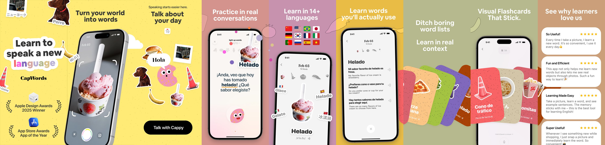

| # | CapWords | Otter |
|---|---|---|
| 1 | `Learn to speak a new language` + 奖项；一台右倾的手机横跨第 1、2 张 | `#1 APP to Record & Transcribe Live` + 奖项；两台角度、大小都不同的斜手机横跨第 1、2 张 |
| 2 | `Turn your world into words` | 第 1 张的延续，右下角一句 `NEVER take notes again` |
| 3 | `Talk about your day`：不放手机，只有贴纸和一个按钮 | `AI Chat for Quick Answers`：立正的手机，气泡从屏幕里飘出来 |
| 4 | `Practice in real conversations`：立正的手机 | `Collaborate, Share & Export`：立正的手机，分享面板压在底部 |
| 5 | `Learn in 14+ languages`：国旗 + 左倾的手机 | `Records in English, Spanish & French`：立正的手机，三种语言的气泡 |
| 6 | `Learn words you'll actually use`：立正的手机 | `Transcribe Meetings, Lectures, Notes, & more`：手机只露出下半截，周围飘着会议 App 图标和头像 |
| 7 | `Ditch boring word lists / Learn in real context`：一叠卡片扇形展开，横跨第 7、8 张 | — |
| 8 | `Visual Flashcards That Stick`：立正的手机 + 卡片 | — |
| 9 | `See why learners love us`：用户评价卡 | — |

从完整套图里还能看出：

- **手机不会一直朝一个方向。** 开场的两张用斜放的手机，而且左倾、右倾都有，大小也不同；中间讲功能的几张多半立正居中；
  个别几张不放手机，或者只露出一部分。
- **界面元素会从手机里跑出来。** Otter 的气泡、分享面板，CapWords 的单词贴纸，都压在手机边框外面。
- **底色可以换。** CapWords 每 1–2 张换一个底色（黄、粉、紫、姜黄、绿、棕），切线就是换色的地方；
  Otter 只有开场和结尾是饱和蓝，中间几张换成浅色。
- **标题位置也不固定。** 多数居中置顶，开场左对齐，Otter 第 2 张的标题在右下角。

| 参考 | 底色 | 第 1 张 | 页与页之间 | 文案 |
|---|---|---|---|---|
| CapWords | 明黄色平铺 | 只有品牌名、一句大标题 `Learn languages from the world around you` 和奖项，不放界面 | 带白描边的贴纸（狗、香蕉、冰淇淋，配上外语单词）跨过切线，一半在这张、一半在下一张 | 只有一句粗体大标题，例如 `Snap a photo. Learn the word.` |
| Otter.ai | 蓝到紫的饱和渐变 | 大号白字 `#1 APP to Record & Transcribe Live` 占半屏，手机斜着从右下角探进来 | 斜放的手机横跨第 1、2 张的切线 | 只有一句大标题，例如 `NEVER take notes again`，放在角落 |

要借鉴的 4 点：

1. **饱和度高的底色。** 用一个纯度高的颜色铺满底色，不用黑底。不一定要很亮，但颜色要饱和。
2. **第 1 张讲清楚“这是什么”，不急着展示界面。** 用一句足够亮眼的文案点出核心卖点，画面简洁、抓人。信息量大的界面放到后面几张。
3. **整组是一张连贯的长图切出来的。** 底图和视觉元素在页与页之间是连续的，有元素横跨切线，而不是一张图一个独立配置。
4. **只有一层文案。** 不要眉标、副标题，每张图只有一句大标题，言简意赅。

对现有大纲的影响（还没定，下一版样式时试）：

| 条目 | 现在 | 按新方向 |
|---|---|---|
| 第 1 张 | 一台手机，里面是信息量很大的代码对话 | 改成开场页：一句大标题，加一个简单的画面（例如 Atu 加一条推送通知，或一台斜放、只露一部分的手机）。代码对话挪到后面，或者放进横跨第 1、2 张的那台手机里 |
| 第 5 张的 `Pair with one scan` | 标题下的第二层小标签 | 去掉，或者把意思并进标题里 |
| 眉标 | 每张都有 | 不用 |
| 跨页元素 | 没有 | 用官网的矢量 Atu 头像当 CapWords 那种贴纸，或者让手机、桌面窗口横跨切线 |
| 手机朝向 | 全部同一个角度 | 错开：开场斜放，左倾右倾都有；讲功能的几张可以立正 |
| 底色 | 黑底加点阵 | 候选：品牌焦糖橙 `#D9803A`（Google Play 横幅图已经在用），或者再亮一档的橙色；也可以试品牌海军蓝 `#1F2D4F` |

不照搬的地方：两个参考的第 1 张都放了奖项和评分（Apple Design Awards、App of the Day、15K+ reviews）。我们没有这些，不能放。

## 设备模型资源（2026-11-07 调研）

两类手机模型：3D 透视（Otter 开场那种）和 2D 正视（Otter 中间几张那种）。

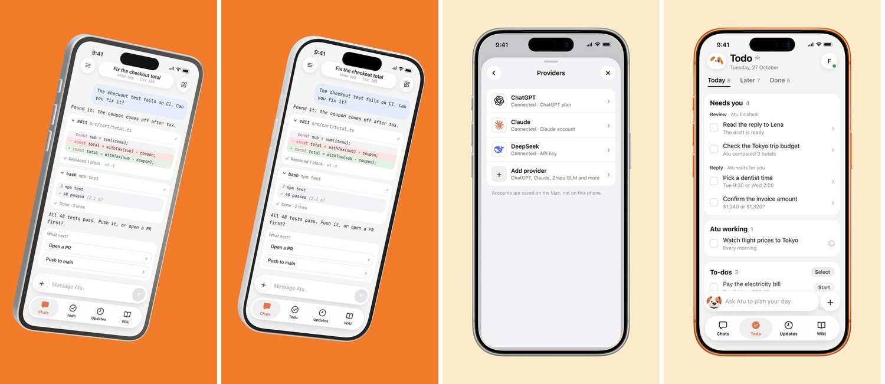

| 类型 | 来源 | 内容 | 许可 | 结论 |
|---|---|---|---|---|
| 3D | [imshaikot/app-preview-craft-skill](https://github.com/imshaikot/app-preview-craft-skill)（Agent Skill，three.js + 无头 Chrome） | iPhone 17 Pro、17 Pro Max、MacBook Pro 16 的 `.glb` | 代码 MIT；模型 CC-BY-4.0，发布时要署名 | **用它**。iPhone 17 Pro 模型作者 Ranguel（[Sketchfab](https://sketchfab.com/3d-models/iphone-17-pro-4541aa8a28324b33a2baaf81d263aaec)）。署名放在商店描述或官网的 Credits |
| 3D | 自建（three.js 圆角长方体加按键） | 只有 iPhone | 自己的 | 备选；细节不如上面 |
| 3D | [jasonkneen/freemock](https://github.com/jasonkneen/freemock) | iPhone 17、MacBook `.glb` | 仓库写 MIT | **不用**：模型节点名是乱码、用了商业级压缩，和 README 说的“原创程序生成”对不上，出处不明 |
| 2D | [Mecury-Labs/mockify](https://github.com/Mecury-Labs/mockify) | 苹果官方 Product Bezels：iPhone 13–17、Air，76 种配色（含 iPhone 17 Pro 银色、宇宙橙、深蓝） | 边框本身遵守苹果的 Design Resources 许可 | **用它**做正视图；也可以直接从 [Apple Design Resources](https://developer.apple.com/design/resources/) 下载 |
| 2D | [jonnyjackson26/device-frames-media](https://github.com/jonnyjackson26/device-frames-media) | 边框 + 屏幕蒙版 + JSON 坐标，到 iPhone 17 Pro Max | — | 备选 |
| 2D | [ParthJadhav/app-store-screenshots](https://github.com/ParthJadhav/app-store-screenshots)（Agent Skill） | 带苹果官方 iPhone、Mac、Watch、iPad 边框，和一套 Next.js 截图编辑器 | MIT | Mac 和 Watch 边框以后可以从这里取 |
| 在线 | [Beveled](https://beveled.app/) | 免费网页工具，2D/3D 都有，用的也是上面那些 CC-BY 模型 | — | 想手动调角度时可以用 |

**苹果规范的限制**（[营销资源和识别标志指南](https://developer.apple.com/cn/app-store/marketing/guidelines/)，原文）：

> 按“原样”使用 Apple 产品图像，不可修改。修改包括添加倒影、阴影、高亮显示或表现为进出产品屏幕的图形元素；裁剪、倾斜或遮挡图像的任何部分；制成动画、翻转或旋转图像；……
>
> 不允许在营销材料中以如下方式使用 Apple 产品：使用 3D 渲染，或者创建任何 Apple 产品仿真图形

也就是说，3D 手机、斜放、出画裁切、从手机里“跑出来”的卡片，都不合这份规范。Otter 和 CapWords 这些都用了，并且已上架；
审核实际会不会因此拒，没有查到确切依据。最稳妥的做法是苹果官方边框、正视、不裁切、不压元素。

## 已出的样式

**样式 A**（2026-11-07）：沿用品牌套件的黑底、点阵、像素等宽字标题、焦糖色强调词。

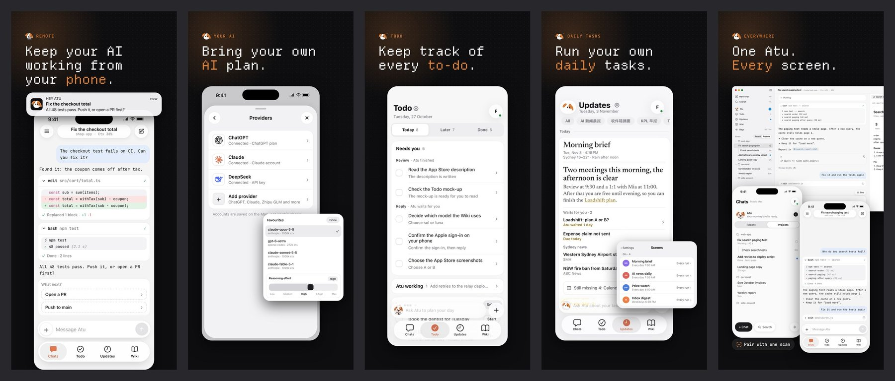

- 样式 A 的生成脚本和原尺寸图当时在临时目录 `~/.pi/tmp/2026-11-07/appstore-v2/`（`src/compose.py`、`out/`），没有保留。
  选定样式后再把脚本移进 `brand/hey-atu-brand-kit/09-generator/`。
- 预览里第 1、2、5 张的手机界面是按现在的 App 用 HTML 还原的；第 3、4 张用的是产品团队的模拟器截图；
  桌面窗口和手表来自产品设计稿。都不是最终截图。

**样式 B**（2026-11-07，先做了第 1–3 张）：按上面“风格方向”的 4 点做。

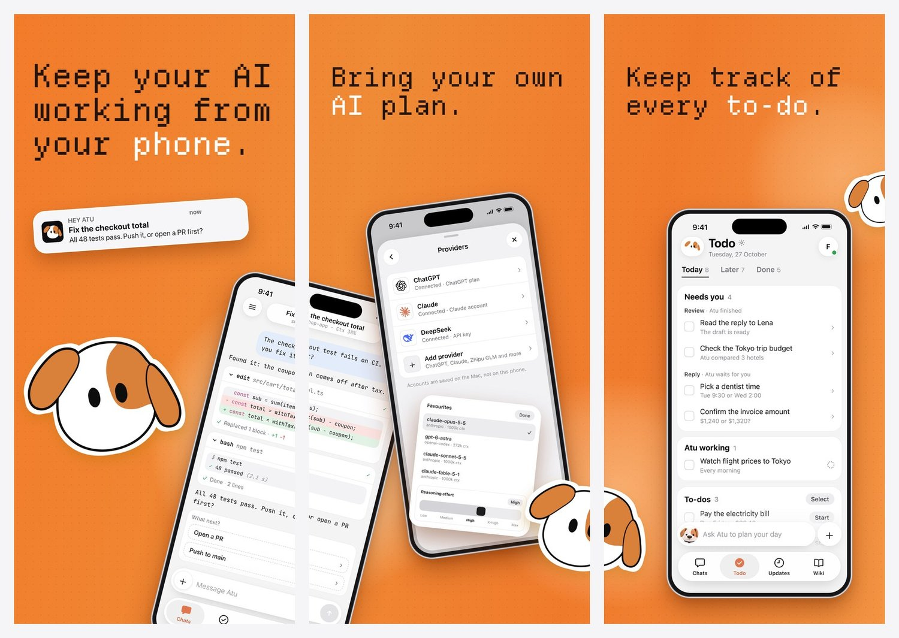

切开之前的整张长图：

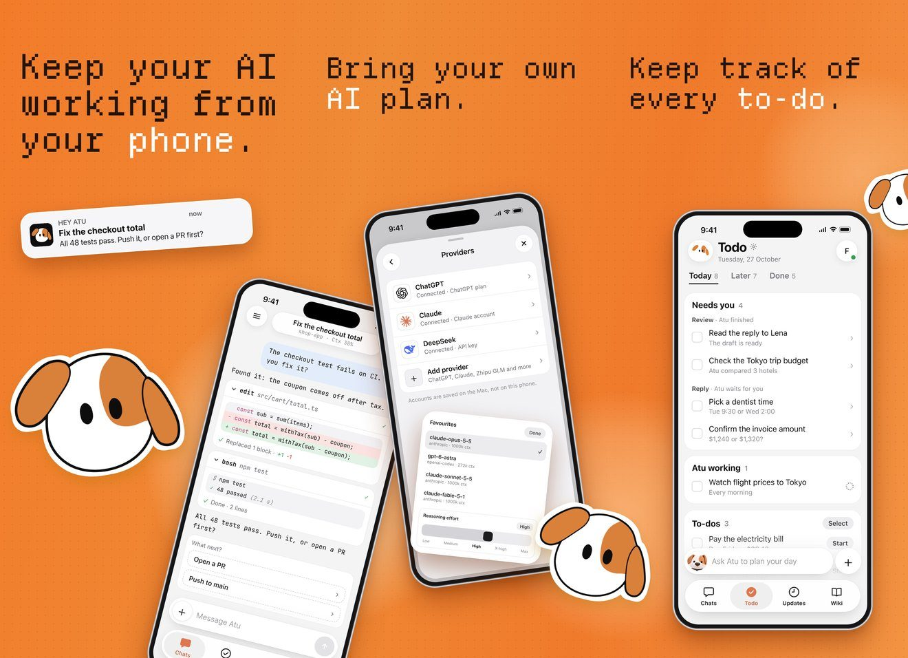

| 项 | 做法 |
|---|---|
| 底色 | 饱和的橙色渐变（约 `#F27B2A` 到 `#F39443`），加一层很淡的深橙点阵；切线后面垫了大块的浅橙光晕 |
| 标题 | 只有一句，用品牌的像素等宽字，深棕色；强调词用白色。第 1 张 150 px，第 2、3 张 125 px |
| 第 1 张 | 大标题占上半部分；推送通知做成贴纸斜放；大号 Atu 头像贴纸在左下；代码对话的手机斜着从右下角探进来 |
| 跨页 | 第 1 张的手机横跨第 1、2 张的切线；一个 Atu 贴纸横跨第 2、3 张的切线；第 3 张右边缘露出半个 Atu，接到第 4 张 |
| 手机 | 角度错开：第 1 张右倾 14°，第 2 张左倾 8°（叠在上面的模型卡右倾 6°），第 3 张立正 |
| 贴纸 | 官网的矢量 Atu 头像 `../pi-remote/site/assets/brand/atu-outline.svg`（带黑描边的版本，在橙底上最清楚），外面加一圈白边；大小和角度都不一样 |

- 第 3 张的 Todo 界面已经换成本文的英文示例数据，用 HTML 还原。
- 生成脚本当时是临时目录里的 `src/compose_b.py`，没有保留。
- 第一版用的是毛绒 Atu 抠图，已按 Xinyi 的意见换成官网矢量头像；标题字体（品牌像素等宽字）已确认。

**样式 C**（2026-11-07，5 张）：开场重度参考 Otter，内容按上面“当前顺序（第二轮）”。蓝色虚线和编号只是标出切线，成品里没有。

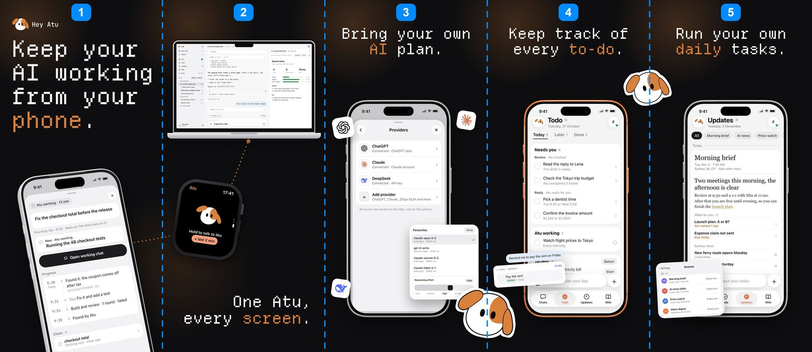

第 1–2 张：方案 A（一块手表）对比方案 B（两块手表）。

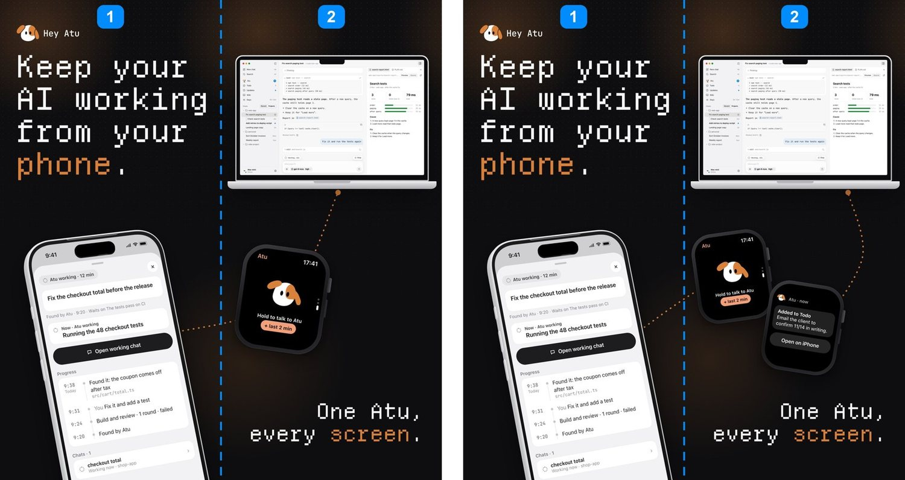

| 项 | 做法 |
|---|---|
| 配色（当前，5 张都一样） | 照样式 A：黑底 `#0E0E10`，白色点阵往下渐隐，每张左上角一团焦糖色光晕；标题白 `#F7F7F8`，强调词焦糖 `#D9803A`；连接设备的虚线也是焦糖色 |
| 配色（弃用） | 橙色开场 + 浅金功能页；以及橙色渐变到浅金。脚本当时在临时目录（`src/compose_c_orange_light.py`），没有保留 |
| 标题 | 品牌像素等宽字。开场标题 184 px、左上；第 2 张右下那句 128 px、右对齐；功能页 120 px、居中 |
| 品牌标 | 第 1 张左上角的横版 Logo（`01-logo/svg/atu-lockup-horizontal-on-dark.svg`），和 Otter 一样 |
| 设备模型（当前，第五轮） | 第 1 张：CC-BY 的 iPhone 17 Pro 3D 模型（Ranguel）。第 2 张：苹果官方 MacBook Air 午夜色（屏幕上方补了菜单栏，窗口不裁）、Apple Watch Ultra 带表带、iPad 横屏。第 3–7 张：苹果官方 iPhone 17 Pro 银色正视边框。第 7 张的手表：苹果官方 Apple Watch Series 11 46mm 银色铝壳（Apple Design Resources 的 `Bezel-Apple-Watch-Series-11-2025.dmg`，从 PSD 里的 2100×3300 原图把表带抠掉）。见上面“设备模型资源” |
| 设备模型（第四轮，弃用） | 第 1 张也用平面手机；第 7 张用带表带的 Ultra，太写实，和官网的手表不像 |
| 设备模型（第三轮，弃用） | 第 1 张 3D 手机，第 2 张自己画的 Mac 和设计稿手表，第 4 张宇宙橙边框（侧键看起来像虚线），风格不统一 |
| 手机模型（上一版） | three.js 渲染的立体 iPhone：银色金属边框（带倒角和厚度）、侧键、黑边、淡淡的玻璃反光，带透视角度。第一版是平面圆角框，Xinyi 觉得不如 Otter 好看，已替换。脚本当时在临时目录（`src/phone3d.html`），没有保留；现在的 3D 手机用 `phone3d-glb.html` |
| 三端 | 手机左倾 9°、向右转 22°（露出左侧按键）；功能页的手机左右小角度转向；Mac 水平，屏幕里是桌面端设计稿；手表右倾 8°。方案 B 的两块手表一左倾一右倾 |
| 跨页 | 第 1 张的手机右下角伸进第 2 张；切线上不放 Atu 贴纸（原来横跨第 4、5 张和第 5、6 张，Xinyi 2026-11-08 去掉）。不再有连设备的虚线 |
| 跑出手机的元素 | 第 3 张的模型卡；第 4 张的待办卡和 Follow up 面板；第 5 张的定时任务卡。都和手机同角度、不旋转 |

- Updates 界面里的新闻改成了虚构条目（`New ferry route opens Monday`、`Fire ban from Saturday`，来源写 `Local news`），不再用真实媒体名。
- 桌面端还是内部版（ADR 0025），上架前要公开，否则第 2 张的 Mac 要换掉。
- 生成脚本在 `brand/hey-atu-brand-kit/09-generator/appstore-v2/`（`build.sh`：`render_screens.py` 出界面，`bezels.py` 放进苹果边框，`compose_c.py` 拼图），定稿 F 的 7 张原尺寸切图在那里的 `out/r6f-*.png`。第三到五轮的脚本没有保留。
- `pyx compose_c.py --p1-flat` 把第 1 张换回平面手机。
